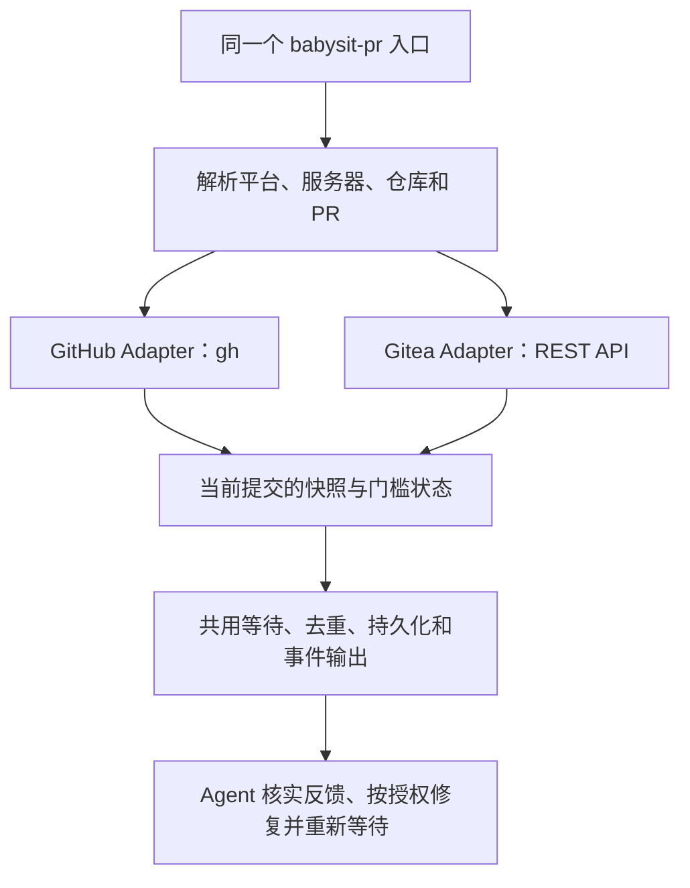

# GitHub / Gitea 双后端 babysit-pr：研究与最小设计

研究日期：2026-11-04。研究范围：官方 API、Swagger、源码和现有本地实现；没有连接用户 Gitea 实例或读取凭据。本文是研究与设计，不是已实现或已验证兼容性的声明。

原始 Skill 来自 **Theo Browne（GitHub：t3dotgg）的 [tstack](https://github.com/t3dotgg/tstack)**。本机安装基线为 `1085050f3baed1ac724caa4a8166145fb2ac88af`；未来若复用原始 Skill / 脚本，须保留其 [MIT 许可与版权声明](https://github.com/t3dotgg/tstack/blob/1085050f3baed1ac724caa4a8166145fb2ac88af/LICENSE)。本次未修改上游、安装入口或运行配置。

## 基线与结论

以截至 2026-11-04 可确认的稳定发布 **Gitea v28.3.0** 为源码基线，tag peeled commit：[`4f5a3e13e5f3aca85d830e3a9024c893b0bbf1e1`](https://github.com/go-gitea/gitea/tree/4f5a3e13e5f3aca85d830e3a9024c893b0bbf1e1)；[官方发布页](https://github.com/go-gitea/gitea/releases/tag/v28.3.0)。API 文档站仍列 `/api/1.25`，故这里只用它核对 REST 路径示例，字段语义以 `v28.3.0` 源码为准。部署实例可通过 `/api/v1/version` 查询自己的版本；不能假定用户实例与此基线一致。

## 核实结果

### 1. PR head/base 与 mergeability

- `GET /repos/{owner}/{repo}/pulls/{index}` 返回 PR；对象字段包括 `head.sha`、`base.sha`、`state`、`draft`、`mergeable`（布尔）、`merged`、`merge_commit_sha`。参见 [`PullRequest` / `PRBranchInfo`](https://github.com/go-gitea/gitea/blob/v28.3.0/modules/structs/pull.go) 与 [API operation](https://docs.gitea.com/api/1.25/operations/repo-get-pull-request/)。
- `mergeable` 是 Gitea 对 PR Git 合并状态的计算值，不代表保护规则、required checks、审批均已满足。真正执行合并的路径另行调用 `CheckPullMergeable`，包含 branch protection、merge options 等检查；参见 [`services/pull/check.go`](https://github.com/go-gitea/gitea/blob/v28.3.0/services/pull/check.go) 及 [`routers/api/v1/repo/pull.go`](https://github.com/go-gitea/gitea/blob/v28.3.0/routers/api/v1/repo/pull.go)。Watcher 不应将 `mergeable:true` 显示为“所有条件通过”。
- PullRequest API 类型将 `mergeable` 定义为 bool，没有三态 unknown 字段；PR 仍在后台检查或接口版本行为不同时，单靠该值无法安全推断“可合并”。取不到/字段缺失应视为 unknown。

### 2. 评论、review、inline 与 resolve

- Issue / PR 对话评论可读：`GET /repos/{owner}/{repo}/issues/{index}/comments`，评论字段有 `id,user,body,created_at,updated_at`；这是 issue 评论列表，不等于 inline review thread。
- Review 列表：`GET .../pulls/{index}/reviews`。`PullReview` 提供 `state,commit_id,stale,dismissed,comments_count,submitted_at` 等。Gitea 的要求修改状态是 `REQUEST_CHANGES`，而非原 GitHub 脚本读取的 `CHANGES_REQUESTED`，需要显式映射。某 review 的 inline 评论：`GET .../pulls/{index}/reviews/{id}/comments`；评论字段包括 `path,position,original_position,commit_id,original_commit_id,resolver`。源码：[`pull_review.go` structs](https://github.com/go-gitea/gitea/blob/v28.3.0/modules/structs/pull_review.go)、[`pull_review.go` routes](https://github.com/go-gitea/gitea/blob/v28.3.0/routers/api/v1/repo/pull_review.go)。
- 有 inline 评论回复 API `POST .../pulls/{index}/comments/{id}/replies`，也有 `POST .../pulls/comments/{id}/resolve` 与 `/unresolve`。这三条路由已在官方 `v1.27.3` 与 `v28.3.0` 源码确认；`v1.25.0` 的路由源码未见这些路径。具体最低支持版本未核实；旧实例应检查其自身 Swagger。API 评论对象没有 GitHub GraphQL `reviewThreads` 同构的 thread 对象 / parent-child 树字段，不能直接视为等价。参见 [`v28.3.0 api.go`](https://github.com/go-gitea/gitea/blob/v28.3.0/routers/api/v1/api.go#L1510-L1550)、[`v1.27.3 api.go`](https://github.com/go-gitea/gitea/blob/v1.27.3/routers/api/v1/api.go#L1425-L1470)、[`v1.25.0 api.go`](https://github.com/go-gitea/gitea/blob/v1.25.0/routers/api/v1/api.go#L1250-L1270)；[resolve 实现](https://github.com/go-gitea/gitea/blob/v28.3.0/routers/api/v1/repo/pull_review.go#L292-L388)。

### 3. Commit statuses、Actions、外部 CI 与 SHA

- Commit status 读端点：`GET /repos/{owner}/{repo}/commits/{ref}/statuses`；合并状态：`GET .../commits/{ref}/status`。单条 status 的状态字段名是 `status`（实现时对照 `modules/structs/status.go` 更正；取值含 `pending/success/error/failure`）、`context`、`description`、`target_url`；这是 commit SHA 上的通用状态记录，不限于 Gitea Actions。参见 [`status.go` structs](https://github.com/go-gitea/gitea/blob/v28.3.0/modules/structs/status.go)、[`status.go` routes](https://github.com/go-gitea/gitea/blob/v28.3.0/routers/api/v1/repo/status.go) 和[官方 status API 文档](https://docs.gitea.com/api/1.25/operations/repo-get-combined-status-by-ref/)。
- Gitea Actions 有只读 `GET /repos/{owner}/{repo}/actions/runs`、`GET .../actions/runs/{run}`、`GET .../actions/runs/{run}/jobs` 及 `/actions/jobs`。Run 有 `head_sha,status,conclusion`；job 也有 `head_sha,status,conclusion`。可按 SHA 对照 PR 当前 `head.sha`；需同时读取所有页及 run/job 状态，且成功的终态才算该 run/job 成功。官方 API 文档列出 [runs](https://docs.gitea.com/api/1.25/operations/get-workflow-runs/)、[run jobs](https://docs.gitea.com/api/1.25/operations/list-workflow-run-jobs/)；当前路由由 [`api.go`](https://github.com/go-gitea/gitea/blob/v28.3.0/routers/api/v1/api.go#L1420-L1452) 确认。
- 外部 CI 可通过 status API 在 commit SHA 上发布状态；status 本身不证明来源是真实 CI、也不携带可验证的 Actions run/job 关联。只可按 context / target URL 展示来源线索。不能把 status 列表为空解释为通过；required contexts 缺项、无权限、未配置 CI、分页不全均不得假绿。
- 源码确认有 PR 的 server-side mergeability / merge 检查，但未发现只读 API 可返回“对当前 head/base 执行真实 merge test 所生成的候选提交 SHA”。如果用其他路径拿到的测试提交 SHA，不能假设它等于 `head.sha`，也不能将其 status 无条件归到 PR 当前 head；若只能看到 run `head_sha` 或 commit status，要求 SHA 精确匹配。候选 merge SHA 的可读 API 关联：**unknown / 未确认公开接口**。

### 4. Protected branches 语义

- `GET /repos/{owner}/{repo}/branch_protections` 可列保护规则；`GET /repos/{owner}/{repo}/branches/{branch}` 的 branch 对象也包含 `protected,required_approvals,enable_status_check,status_check_contexts,effective_branch_protection_name`。单个 branch 请求成功且响应中确实包含 `protected:false` 时，普通有该分支读取权限的 token 即可权威得知“这个分支当前没有匹配到有效 branch-protection 规则”；这不披露仓库全部规则。其 handler 对目标 branch 调用 `GetFirstMatchProtectedBranchRule` 后构造 Branch 响应，见 [`branch.go`](https://github.com/go-gitea/gitea/blob/v28.3.0/routers/api/v1/repo/branch.go#L59-L88)。`GET /repos/{owner}/{repo}/branch_protections` 才用于看全规则，且要求 token 与 `reqAdmin()`。branch-protection API 返回的规则字段包括 `status_check_contexts,required_approvals,dismiss_stale_approvals,ignore_stale_approvals,block_on_outdated_branch,block_on_rejected_reviews,block_on_official_review_requests,block_on_codeowner_reviews,enable_bypass_allowlist,bypass_allowlist_* ,block_admin_merge_override`。参见 [`repo_branch.go`](https://github.com/go-gitea/gitea/blob/v28.3.0/modules/structs/repo_branch.go)。
- 这些字段能识别状态检查上下文、审批数、stale approval 策略、outdated branch 阻止条件和管理员 bypass 配置；但 `required_approvals` 是规则门槛，不能代替当前 review 状态计算。还要考虑 review `state/stale/dismissed`、当前 head SHA 与 status contexts。
- 保护规则 list/get 路由要求 token 且 `reqAdmin()`（仓库 admin 权限或站点管理员），见 [`api.go`](https://github.com/go-gitea/gitea/blob/v28.3.0/routers/api/v1/api.go#L1397-L1406) 和 [`reqAdmin`](https://github.com/go-gitea/gitea/blob/v28.3.0/routers/api/v1/api.go#L458-L470)。该端点成功且返回空数组才可称“无匹配规则”；403/404、未认证或无 admin 权限必须是 unknown。管理员 bypass 由 allowlist 与 `block_admin_merge_override` 等规则决定，单看用户是 admin 不足以推导此 PR 一定 bypass 或不能 bypass。

### 5. 版本、认证、路径与分页

- 版本端点：`GET /api/v1/version`，无需认证；源码路由标为 public，见 [`api.go`](https://github.com/go-gitea/gitea/blob/v28.3.0/routers/api/v1/api.go#L1087-L1092)。
- API 根路径是实例 URL + `/api/v1`；部署在子路径时需保留该子路径。Swagger JSON 在运行时把 `/GITEA-API-APP-SUBURL/` 替换为实例的 `AppSubURL`，见 [`swagger_json.go`](https://github.com/go-gitea/gitea/blob/v28.3.0/routers/web/swagger_json.go#L20-L36)。不可硬编码域名或假设 root deployment。
- 公开仓库的只读数据通常可匿名读取；私有仓库需可读取该 repo / 对应 unit 的 token。PR、status、Actions 路由各自有 repo-reader 权限检查；保护规则额外要求 admin。具体 token scope 取决于实例版本 / token 类型，应给最小只读 repo 权限，不给写权限。403、404 或授权错误不能转成“无规则 / 无 CI”；Gitea 对不可见私有 repo 可返回 404。
- list API 使用 `page` / `limit`；遍历到没有更多数据或按 `X-Total-Count` 校验完成后，才可做全集结论。仅取第一页不能证明不存在 required context / review / run。官方路由约定分页与 `X-Total-Count`：[`guidelines-backend.md`](https://github.com/go-gitea/gitea/blob/v28.3.0/docs/guidelines-backend.md)。

### 6. 最小只读 watcher 能支持什么

- **可准确展示（数据完整、权限足够且版本字段符合预期时）**：PR 开 / 关 / draft、当前 head/base SHA、Git 层 mergeability 提示；issue 对话评论；review 状态与 stale/dismissed 字段；inline 评论及 resolver；commit statuses；Actions runs/jobs；可见 branch protection 条款。
- **必须保留 unknown / 不得假绿**：PR 是否已满足全部合并策略（特别是保护规则不可读时）；required contexts 清单缺失或分页 / token 权限不完整；外部 CI status 与 CI 身份、Actions run 的确定关联；无 status 的含义；真实候选 merge SHA 和其 CI 结果与当前 PR head 的对应；不同实例版本或自定义插件改变的语义。
- 最小安全判断：先确认 `/version` 与 API 正常；读取完整 PR 数据并固定 `head.sha`。先用普通 reader 可读的 branch 对象判断当前分支是否受保护，并取得其公开的 status contexts / approval 门槛；需要完整规则时才查询要求 admin 的保护规则 API，读不到的必要条款保留 unknown，不要求用户为监控默认扩大权限。对每个 required context 查该精确 SHA 的 statuses，对 Actions run 校验 `head_sha`、run/job 终态；所有必要数据完整且满足显式规则前，显示 unknown / pending，而不是 ready。

## 风险表

| 风险                                 | 误判方式                                       | watcher 处理                                                                                                      |
| ------------------------------------ | ---------------------------------------------- | ----------------------------------------------------------------------------------------------------------------- |
| `mergeable` 被当成 ready             | 忽略保护规则、checks、审批                     | 仅作冲突 / mergeability 提示                                                                                      |
| statuses 为空或只读一页              | 空集合假绿、漏 required context                | 全部分页；缺项 / 失败访问标 unknown                                                                               |
| 外部 CI / 测试 merge SHA             | SHA 或来源错配到当前 PR                        | 精确 SHA 比对；未建立关联不推断                                                                                   |
| branch protection 403/404 / 字段缺失 | 当成无保护规则，或把单分支状态误当全仓规则可见 | 单分支 API 成功且 `protected:false` 可确认该 branch 无匹配规则；读取全规则仍要求 admin，错误 / 字段缺失标 unknown |
| token 不足或版本差异                 | 404 当数据不存在、字段缺失当 false             | 记录版本与权限状态；保留 unknown                                                                                  |

## 最小改造设计

### 一个入口、两个 Adapter，不做通用 Forge SDK

可行。改造对象限定为 `babysit-pr`：共用等待、事件去重、锁、持久化和输出；平台查询与语义判断留在两个 Adapter 中。GitHub 保留 `gh` 的原生认证和查询能力，Gitea 使用 Python 标准库 HTTP / JSON 调 REST API，不新增 SDK 或 npm 依赖。

内部 Interface 只需 `fetch_snapshot(target)`：输入包含平台、实例根路径、仓库和 PR；输出包含 head/base SHA、PR 生命周期、可见反馈和必要门槛。每个门槛保留 `pass / pending / blocked / unknown / not_required` 及理由；不能压成一个 `mergeable` 布尔值。各 Adapter 自己处理平台规则，共用 Implementation 不必理解每一个 Gitea / GitHub 字段。

### 第一版做到哪里

- 同时监控两端的 PR 状态、评论、review、当前提交上的 CI 状态；出现失败或冲突时交回 agent，不让模型负责定时轮询。
- GitHub 沿用原有 `gh` / GraphQL 读取能力；可用字段含 `isDraft`、`headRefOid`、`baseRefOid`、`reviewDecision`、`mergeStateStatus`、`statusCheckRollup`。CI 的 `pass/fail/pending/skipping/cancel` 分类可继续使用 `gh pr checks`。参见 [view](https://cli.github.com/manual/gh_pr_view) 与 [checks](https://cli.github.com/manual/gh_pr_checks)。
- Gitea 读取通用 commit statuses，按需补充 Actions run / job 详情；不把“支持 Gitea Actions”误写成“已覆盖所有外部 CI”。外部 CI 必须确实回写状态，或有另行明确的查询能力。
- Gitea inline 数据按其实际结构展示为评论 / 解决状态，不伪造 GitHub thread 树或等价的 thread 数量。不能证实的讨论门槛保留 unknown；不自动 resolve 或把“回复过”当作“已解决”。
- 评论回复、读取失败日志等操作写入平台对应的使用说明；借鉴现有 `create-gitea-pr` 的直接 REST 约定，不把其中项目专属工单规则复制到通用 Skill。监控脚本自身只读，回复、push、resolve 由 agent 在授权范围内执行。
- `green` 只描述 CI；`ready` 必须覆盖已知且适用的审查、冲突、分支与 CI 门槛。任一必要门槛 unknown 就交接不确定性，不声称全部通过。机器人按仓库实际配置 / 明确请求处理，不能让 Gitea 永远等待原脚本硬编码的 Greptile / Macroscope。
- 不增加自动合并。即使所有已知门槛通过，也不构成合并授权；最终服务器保护规则仍是权威。

### 需要修改到的地方

| 位置              | 最小改动                                                               |
| ----------------- | ---------------------------------------------------------------------- |
| `SKILL.md`        | 平台路由、按需加载对应说明、统一的等待与交接规则                       |
| `scripts/pr-wait` | 从现有读取逻辑抽出两个具体 Adapter；共用等待与状态记录                 |
| 平台说明          | GitHub / Gitea 的读取、回复、权限、版本和能力缺口；Gitea 默认直接 REST |
| 聚焦测试          | 两端响应夹具、共用状态机、错误与身份隔离                               |
| 许可与来源        | 保留 Theo / tstack 的 MIT 声明并注明本地修改范围                       |

不复制九个 Skill，不做插件注册表、Webhook 服务、常驻 daemon 或 UI。`full-send`、`full-stop`、`takeover`、`file-pr` 仍有 GitHub 专用步骤；只改 watcher 后，不能宣称这些完整工作流也兼容 Gitea。

### 必须防住的误判

1. **串实例状态**：本机原版锁 / 状态文件只按 `owner/repo + PR` 命名。双后端后须纳入平台和完整实例根路径，避免两个服务器的 `team/app#123` 互相占锁或吞事件。[原脚本](https://github.com/t3dotgg/tstack/blob/1085050f3baed1ac724caa4a8166145fb2ac88af/skills/babysit-pr/scripts/pr-wait)
2. **旧提交假绿**：CI、review 有效性和稳定快照绑定当前 head/base；head、base 或规则变化后重新判断。分页必须完整；拉取期间 head 变化就丢弃不一致快照重读，不能只比较检查名称和颜色。
3. **空数据假绿**：缺 required context、查询失败、未知版本字段都不能转成成功。GitHub 本身也将“没有 statuses”的 combined state 定为 pending，而非 success；check runs 与 commit statuses 是两种来源，不能只读取一种便断言 CI 全过。[statuses](https://docs.github.com/en/rest/commits/statuses) · [check runs](https://docs.github.com/en/rest/checks/runs)
4. **权限越大判断越乐观**：管理员可以 bypass 并不代表普通贡献者可合并；权限不足也不代表仓库没有规则。遵守仓库政策，不用写入 / 尝试合并来探测权限。[GitHub 保护规则](https://docs.github.com/en/repositories/configuring-branches-and-merges-in-your-repository/managing-protected-branches/about-protected-branches)
5. **把自定义域名都认成 Gitea**：GitHub Enterprise 也使用自定义域名。平台不明确时用已配置实例信息或产品探测；仍不明确则要求显式选择。保留 Gitea 部署子路径。
6. **凭据发错服务器**：token 必须绑定已确认的实例根路径，禁止跨源重定向时转发认证；不因为 PR 评论或链接要求就向新主机发送凭据。评论和日志只作数据，不作新的执行授权。

### Delay 与运行环境

建议首次立即获取快照，之后默认每 **60 秒**轮询；遇到限流遵守服务端等待要求并退避，不做忙轮询。初次基线抑制旧历史的重复通知，但仍展示当前已存在的阻塞项。只差必要人工决定时直接交接，不持续空等审批。

Skill 名称继续留在 `coreSkills` 之外，通过 `skill_search` 查找后读取，保留用户要求的延迟加载。此处的按需发现与 60 秒网络轮询是两回事；本次没有改变任何运行参数。

脚本 stdout 不等于后台唤醒。第一版可沿用长命令等待或 `any-change` 事件后返回，但会话 / 进程必须继续存活，不能声称退出 Pi 后还会自动修复。T3 Code 的 GitHub 原生 watcher 可继续优先使用；同一 PR 只选一个 watcher。若需要 Pi 空闲时事件主动开新一轮，后续单独接原生消息投递，不把它混入这次双后端读取改造。[Pi 消息与后台 Bash 语义](https://github.com/earendil-works/pi/blob/v1.4.0/packages/coding-agent/docs/rpc-commands.md)

本地 fork 中的 `pi-github-watch` 已有 Pi 消息唤醒逻辑，但它仍是 GitHub 专用、不是完整就绪判定器，当前配置也未启用；不适合为了这次改造直接再安装一套监控。其源码基线为 `c79c8392361c8f2cb72d3c1fd6c842bb0d535436` 的 `packages/pi-github-watch/`，仅作为未来宿主投递的参考。

### 验证与落地顺序

先用两端固定响应夹具做离线测试：同号 PR 不同实例、超过一页的评论 / 状态、旧 SHA 成功但新 SHA pending、缺 CI / required context、403/404、陈旧 review、base 移动、取消 / 重跑检查，以及跨源认证隔离。共享的等待 / 就绪测试必须同时跨过两个 Adapter 的同一个 Interface，不只测试各自的 JSON 转换。

之后先对用户实例做授权的只读探测：版本、实际 Swagger、当前 token 可见字段、CI 回写方式。再用测试 PR 验证修复后的事件与状态。旧 Gitea 缺字段时明确降级，不伪造支持，也不通过扩大 token 权限强行追求 ready。

本次完成了官方发布 / tag / 关键字段核对与本地源码分析；没有实现新 Skill、运行 watcher、执行真实 CI 或操作 PR。没有删除项，已安装的八项仍指向原始上游。双后端代码和真实实例兼容性尚未验证。
