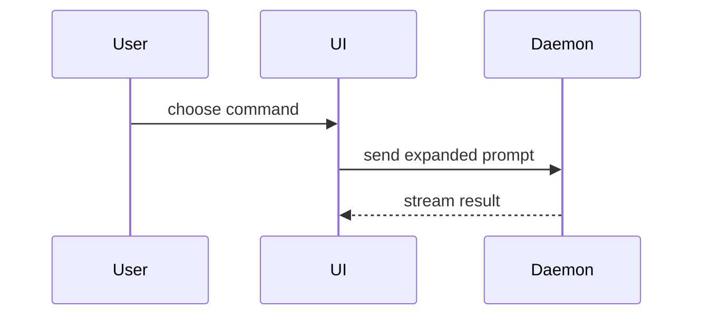

Help the user understand the current topic of conversation visually. Skip the preamble and keep prose brief. Pick the smallest view that makes the key point clear.

### Choose a view

Honor a requested tool or deliverable format. When editing an existing spec, keep its tool and format.

| Need                                                                                  | Default                  |
| ------------------------------------------------------------------------------------- | ------------------------ |
| Logic, calls, components, directories, or code changes                                | Code sketch or diff      |
| Exact values, field mappings, or item-by-item comparison                              | Markdown table           |
| Ordinary flows, states, sequences, classes, ER, mindmaps, timelines, or Git histories | Native Mermaid rendering |
| One quick single-series bar/line chart, index-based point plot, sparkline, or heatmap | Host-native charts       |
| Clicking, input, switching views, or other actual interaction                         | HTML                     |

Use native charts for a quick standalone plot.

- Show logic or an algorithm as pseudocode:

```text
on(save)
  if content is unchanged
    return cached result
  write new content
  return fresh result
```

- Show runtime control flow as a call tree:

```text
submitForm
  createSession
    persistPrompt
    launchAgent
  navigateToSession
```

- Show UI structure as a component tree, including state and module boundaries that matter:

```tsx
<SessionPage> (apps/example/src/routes/session.tsx)
  useSessionEvents()
  <SessionToolbar>
    <RunSkillButton> (packages/ui)
```

- Show file responsibility or a broad refactor as a shallow file tree:

```text
src/
├── commands/       # parses user actions
├── sessions/       # owns session state
└── transport/      # sends API requests
```

- For ordinary component interaction, control flow, or data flow, use the native Mermaid route:



- Use `diff` when the point is what changes and the surrounding shape already exists. Match the diff shape to the topic.

For a component change:

```diff
 <SessionPage>
   useSessionEvents()
   <SessionToolbar>
+    <RunSkillButton />
   <SessionTimeline>
+    <SkillResultCard />
```

For a file-layout change:

```diff
 src/
 ├── commands/
+│   └── show-me.ts       # expands the slash command
 ├── sessions/
-└── transport.ts
+└── transport/
+    ├── client.ts
+    └── stream.ts
```

For a call-tree or call-stack change:

```diff
 submitForm
   createSession
     persistPrompt
+    expandSkillMention
     launchAgent
-  navigateToSession
+  navigateToSession
+    subscribeToEvents
```

For a state or control-flow change:

```diff
 on(save)
-  write content
+  if content is unchanged
+    return cached result
+  write new content
+  invalidate cache
```

- Show the whole block when most of it is new, when omitted context would hide ownership or order, or when the user needs a copyable target shape:

```ts
function expandSkill(command: string): string {
  const skillName = command.slice(1);
  return `use the ${skillName} skill`;
}
```

- Follow the selection above and split dense concepts into smaller views. When HTML is explicitly requested or a static figure cannot convey the required layout or interaction, write one focused HTML file — a diagram, an infographic, or a short slide deck, whichever fits the point. Match the product's colors, type, spacing, and components; use real labels and data; support desktop and mobile. Then open it for the user.

### guidance

Place each visual next to the short text it supports. Keep only the calls, files, props, states, and boundaries needed to answer the user's current question or the options to resolve the current discussion point.

You may use one of these, you may use several, it is unlikely you will use all of them. Use your judgement and don't overwhelm the user.

### Pi native rendering

- Use this Mermaid route for the supported ordinary diagram types below.
- In Pi, the installed `pi-lovely-mermaid` extension renders top-level Mermaid fences directly; keep them outside lists and blockquotes. Native `markdown.mermaid: off` is intentional; no extra drawing tool or settings change is needed.
- For native charts, write top-level `chart` fences for `pi-unicode-charts`: `type: bar|line|scatter|sparkline|heatmap`, optional `title:`, then `data:` and rows such as `Label 42`. Its scatter uses input order for x.
- Ordinary Markdown tables are styled by `pi-borderless-tables`; keep them as Markdown tables rather than drawing their borders by hand.
- Supported terminal diagrams include flowcharts with subgraphs, sequence, state, class and ER diagrams. Also available: `mindmap` for hierarchies, `timeline` for chronological events, `gitGraph` for commit/branch history and `pie` for proportions (displayed as bars).
- Use `classDef` / `:::class` when categories or states benefit from styling: `fill`, `stroke`, `color` and `font-weight:bold` are supported. Unstyled parts follow Pi's current theme.
- Node links use `click NodeId "https://..."`; only the label text is clickable, and only when the terminal supports hyperlinks.
