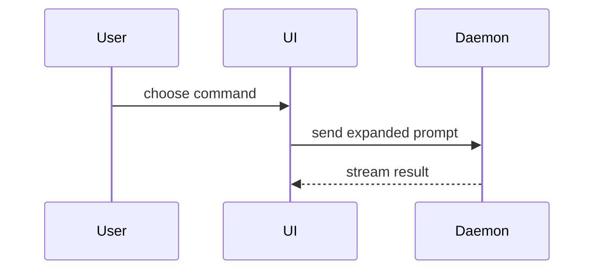

Help the user understand the current topic of conversation visually. Skip the preamble and keep prose brief. Pick the smallest view that makes the key point clear.

Expand `~` to the current user's home directory before reading the installed-skill paths below.
If a referenced skill is absent, use a faithful installed alternative or report the missing prerequisite.

### Choose a view

Honor a requested tool or deliverable format. When editing an existing spec, keep its tool and format.

| Need                                                                                                               | Default                                                        |
| ------------------------------------------------------------------------------------------------------------------ | -------------------------------------------------------------- |
| Logic, calls, components, directories, or code changes                                                             | Code sketch or diff                                            |
| Exact values, field mappings, or item-by-item comparison                                                           | Markdown table                                                 |
| Ordinary flows, states, sequences, classes, ER, mindmaps, timelines, or Git histories                              | Native Mermaid rendering                                       |
| One quick single-series bar/line chart, index-based point plot, sparkline, or heatmap                              | Host-native charts; GlyphCSS if the host has no chart renderer |
| Wireframes, research results, product plans, design-system/handoff/motion figures, or composed readouts/dashboards | Glyph kit                                                      |
| Specialist diagrams or multi-series, layered, true-XY, transformed, or non-linear/time-scale data plots            | GlyphCSS                                                       |
| Clicking, input, switching views, or other actual interaction                                                      | HTML                                                           |

Use native charts for a quick standalone plot; use Glyph kit when the plot belongs to a product/research deliverable. For boards, quadrants, journeys, funnels, and simple schedules, default to Glyph kit; use GlyphCSS when those types arrive as Mermaid source, or for date/dependency-based Gantt charts.

- Show logic or an algorithm as pseudocode:

```text
on(save)
  if content is unchanged
    return cached result
  write new content
  return fresh result
```

- Show runtime control flow as a call tree:

```text
submitForm
  createSession
    persistPrompt
    launchAgent
  navigateToSession
```

- Show UI structure as a component tree, including state and module boundaries that matter:

```tsx
<SessionPage> (apps/example/src/routes/session.tsx)
  useSessionEvents()
  <SessionToolbar>
    <RunSkillButton> (packages/ui)
```

- Show file responsibility or a broad refactor as a shallow file tree:

```text
src/
├── commands/       # parses user actions
├── sessions/       # owns session state
└── transport/      # sends API requests
```

- For ordinary component interaction, control flow, or data flow, use the native Mermaid route:



- Use `diff` when the point is what changes and the surrounding shape already exists. Match the diff shape to the topic.

For a component change:

```diff
 <SessionPage>
   useSessionEvents()
   <SessionToolbar>
+    <RunSkillButton />
   <SessionTimeline>
+    <SkillResultCard />
```

For a file-layout change:

```diff
 src/
 ├── commands/
+│   └── show-me.ts       # expands the slash command
 ├── sessions/
-└── transport.ts
+└── transport/
+    ├── client.ts
+    └── stream.ts
```

For a call-tree or call-stack change:

```diff
 submitForm
   createSession
     persistPrompt
+    expandSkillMention
     launchAgent
-  navigateToSession
+  navigateToSession
+    subscribeToEvents
```

For a state or control-flow change:

```diff
 on(save)
-  write content
+  if content is unchanged
+    return cached result
+  write new content
+  invalidate cache
```

- Show the whole block when most of it is new, when omitted context would hide ownership or order, or when the user needs a copyable target shape:

```ts
function expandSkill(command: string): string {
  const skillName = command.slice(1);
  return `use the ${skillName} skill`;
}
```

- Follow the selection above and split dense concepts into smaller views. When HTML is explicitly requested or a static figure cannot convey the required layout or interaction, write one focused HTML file — a diagram, an infographic, or a short slide deck, whichever fits the point. Match the product's colors, type, spacing, and components; use real labels and data; support desktop and mobile. Then open it for the user.

### Glyph kit

- For screen wireframes, research results, product plans, design-system/handoff or motion figures, read the installed [Glyph kit skill](~/.agents/skills/glyph-kit/SKILL.md). Follow its type guides, data-source rules and validation; draw covered figures with its official CLI.
- Save specs beside the project/document that uses them. For an ad-hoc chat, use a task directory under `~/.local/share/agent-artifacts/`; keep outputs outside the installed skill.
- For chat, render `--to text` and place the generated output unchanged in a top-level `text` fence. Shorten labels or choose a smaller layout if the figure is too wide.
- For an editable Markdown document, follow the kit's `--with-spec` and `redraw` workflow. Use HTML or exports when the requested deliverable needs them.

### GlyphCSS

- Use it for Sankey, radar, treemap, area, packet, C4, Architecture, Requirement, Block, date/dependency Gantt, or advanced data plots from the selection above.
- Read the installed [GlyphCSS skill](~/.agents/skills/glyphcss-diagrams/SKILL.md) directly by this path; its automatic discovery is disabled. Follow its input, size-budget, and diagnostic rules and run its bundled renderer.
- Paste successful stdout unchanged in a top-level `text` fence. Inspect diagnostics as well as the exit code: a nonzero exit, `GLYPH_SKILL_UNFIT`, `label-folded`, `label-dropped`, or lost data/nodes/connections requires a faithful alternative or an explicit limitation.
- Keep the original labels, values, units, and connections. Prefer a Chinese-capable route for Chinese labels; never accept `??` substitutions or silently translate, shorten, or omit input to make a render pass.

### guidance

Place each visual next to the short text it supports. Keep only the calls, files, props, states, and boundaries needed to answer the user's current question or the options to resolve the current discussion point.

You may use one of these, you may use several, it is unlikely you will use all of them. Use your judgement and don't overwhelm the user.
